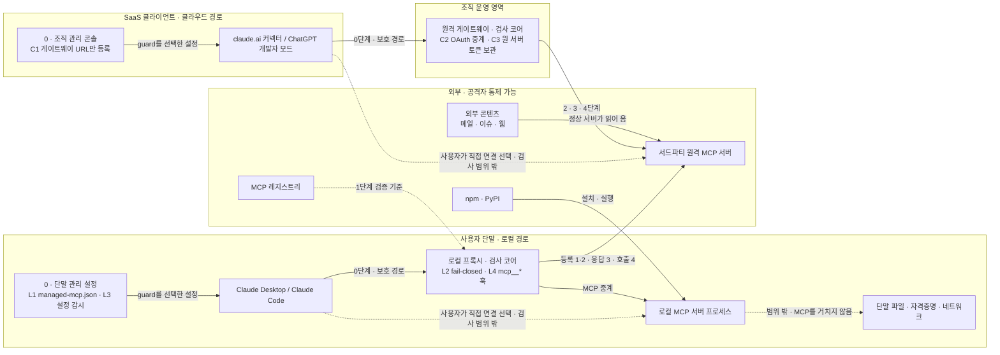

# Architecture

## Design Intent

`mcp-guard`는 AI 클라이언트가 MCP 서버를 신뢰하기 전에 먼저 실행되는 검사 계층입니다. 설계 원칙은 세 가지입니다.

1. **선택한 보호 경로의 진입 통제**: 사용자는 mcp-guard 사용 여부를 선택합니다. 사용하면 해당 연결은 검사 코어를 거치고, 직접 연결을 선택하면 코어를 거치지 않습니다 (0단계, 설계 논의).
2. **정상 연동 먼저, 유형별 차단은 그다음**: 1단계에서 정상 MCP와만 연동되게 하고, 2~4단계에서 그래도 남는 위장 유형을 하나씩 막습니다.
3. **A가 결정하고 B는 거들기만**: 차단·허용은 결정적 검사(A)가 정합니다. 분류기·LLM 같은 확률적 신호(B)는 위험도를 올리기만 하고, 판정을 허용 쪽으로 바꾸지 못합니다.

이 문서는 설계입니다. 현재 무엇이 구현됐는지는 [SECURITY.md](../../SECURITY.md)에 적습니다.

## Source Drawings

| 도면 | 파일 | 보여주는 것 |
| --- | --- | --- |
| v2 | [Architecture.png](../Core_images/Architecture.png) | 실행 순서, 0단계 진입 강제, 검사 코어 1~4단계 |
| A-01 | [Defense_Paths.png](../Core_images/Defense_Paths.png) | 공격 유형별 방어 경로와 남는 구멍 |
| A-02 | [Deployment_map.png](../Core_images/Deployment_map.png) | 구성 요소의 인프라 위치 |

**최신 기준은 A-01과 A-02입니다.** 문서, 코드, v2 도면이 서로 다르면 A-01·A-02를 따릅니다.

문서 안의 출처 표기는 도면의 표기를 따릅니다.

| 표기 | 뜻 |
| --- | --- |
| (원본 명시) | 원본 v2 다이어그램에 있는 내용 |
| (해석) · (추론) | 원본에 없고 도면을 그리면서 해석·추론한 내용 |
| (미기재) | 원본에서 정하지 않은 내용 |
| (미확인) | 사실인지 확인하지 못한 전제 |
| (설계 논의) | 도면에는 없고 설계 논의에서 정한 내용 |

## 실행 순서

아래 두 경로는 사용자가 mcp-guard를 선택한 연결에 적용합니다. 직접 연결을 선택한 경우 클라이언트는 원 서버에 그대로 연결하며 0~4단계 검사는 적용되지 않습니다 (설계 논의).

### 로컬 경로: Claude Desktop · Claude Code

1. 클라이언트가 시작됩니다.
2. 단말 관리 설정(L1)에 있는 mcp-guard 항목만 불러옵니다.
3. 검사 코어가 먼저 기동합니다.
4. 코어가 응답하지 않으면 연결을 차단합니다 (L2 fail-closed).
5. 1·2단계를 통과한 서버만 연결합니다.
6. 이후 응답은 3단계를, 호출은 4단계를 거칩니다.

### 클라우드 경로: claude.ai 커넥터 · ChatGPT 개발자 모드 · Gemini Enterprise

1. 클라이언트는 게이트웨이 URL만 호출합니다 (C1).
2. 게이트웨이가 2단계 등록 검사를 마친 뒤 원 서버에 연결합니다.
3. 이후 응답은 3단계를, 호출은 4단계를 거칩니다.

A-02는 원격 게이트웨이 → MCP 서버 구간에 2·3·4단계만 둡니다. 1단계(레지스트리 검증, 2-A5 버전 고정, 코드 행동 분석)는 단말에 설치하는 패키지가 들어오는 로컬 경로에 놓입니다. v2 도면의 "1·2단계 후 원 서버 연결"은 이 기준으로 대체합니다.

## 배치

로컬 프록시와 원격 게이트웨이는 **같은 검사 코어**를 실행합니다. 둘의 차이는 진입 방식(L 또는 C)과 상태를 저장하는 위치뿐입니다.

원격 게이트웨이를 어디에 호스팅할지는 원본에 없습니다 (미기재). 설계 논의에서 AWS로 정했습니다 (설계 논의, D6-22): EC2에서 게이트웨이와 Caddy(HTTPS)를 Docker compose로 돌리고, `per_user` 원 서버 토큰은 Secrets Manager, M1 감사 로그는 CloudWatch Logs에 둡니다. 감사 로그의 로컬 JSON Lines 파일은 장애 대비 사본입니다.

## 0단계 · 보호 경로 진입

사용자가 guard를 활성화한 연결은 검사 코어를 거칩니다. 사용자가 직접 연결을 선택하면 원 서버에 그대로 연결합니다. 이 선택은 허용된 동작이며, 직접 경로에서는 0~4단계 방어가 동작하지 않습니다 (설계 논의). 보호 경로를 선택한 뒤 설정 변경 등으로 의도치 않게 코어를 건너뛰는 경우가 0단계의 우회 대상입니다.

원격 게이트웨이 MVP의 보조 통제(설계 논의): 관리자가 등록한 서버의 이름·네임스페이스·전송 방식·URL·등록 출처를 첫 사용 때 정책과 대조하고 승인 기록에 고정합니다. 이후 요청은 승인 기록과 현재 설정·정책의 일치 여부만 확인합니다. 기록이 없거나 신원이 바뀌면 차단하고, 변경분은 운영자가 다시 승인합니다. 이는 guard를 선택한 연결의 L1–L4 또는 C1–C3 경로 통제·원격 서버 운영자 인증을 대체하지 않습니다. 도구 정의의 재검사는 2단계에서 계속 수행합니다.

| ID | 위치 | 정의 |
| --- | --- | --- |
| L1 | 단말 관리 설정 | guard를 선택한 관리 설정에는 `managed-mcp.json`의 mcp-guard로 감싼 항목을 배포합니다. 사용자의 직접 연결 선택은 허용합니다 (설계 논의). 구현은 독점 배포 대신 비독점 `.mcp.json`을 씁니다 (D6-10, 설계 논의). |
| L2 | 로컬 래퍼 | 래퍼가 검사 코어를 먼저 띄웁니다. 코어가 응답하지 않으면 원 서버에 연결하지 않습니다 (fail-closed). |
| L3 | 단말 | 설정 파일을 감시하다가 감싸지 않은 항목이 생기면 다시 감쌉니다(재래핑). 사후 복구이지 강제는 아닙니다. |
| L4 | Claude Code 훅 | `mcp__*` 도구 호출 전후에 코어가 한 번 더 판정합니다. |
| C1 | 조직 관리 콘솔 | Owner 권한으로 게이트웨이 URL만 커넥터로 등록합니다. |
| C2 | 원격 게이트웨이 | OAuth를 중계합니다. |
| C3 | 원격 게이트웨이 | 원 서버 토큰은 게이트웨이만 보관합니다. 따라서 클라이언트는 원 서버 토큰을 갖지 않습니다 (해석). |

다음은 도면에 나타난 보호 경로의 관리 수단입니다. 사용자의 직접 연결 선택까지 금지하는 전역 강제 수단으로 해석하지 않습니다 (설계 논의).

| 클라이언트 | 수단 | 강제 여부 |
| --- | --- | --- |
| Claude Code | L1 · L2 · L4 | guard를 선택한 설정의 보호 경로 통제 (설계 논의) |
| Claude Desktop | L1 · L2 · L3 | 관리 정책으로 보호 경로를 통제할 수 있는지 (미확인) |
| claude.ai (조직 요금제) | C1 · C2 · C3 | guard를 선택한 커넥터의 보호 경로 통제 (설계 논의) |
| ChatGPT 개발자 모드 | C1 · C2 · C3 | 보호 경로 통제 방법 (미확인) |
| Codex | C2 · C3 (원격 연결) | 보호 경로 통제 방법 (미확인). 도면에는 없는 클라이언트입니다 (설계 논의) |
| Gemini Enterprise | C1 · C2 · C3 | 관리자가 Custom MCP Server로 게이트웨이를 등록하고, 게이트웨이에는 사전 등록 클라이언트(client secret)로 들어옵니다. 다른 경로를 막는 방법은 미확인. 도면에는 없는 클라이언트입니다 (설계 논의, D6-26) |
| Gemini CLI | C2 · C3 (원격 연결) | 보호 경로 통제 방법 (미확인). 도면에는 없는 클라이언트입니다 (설계 논의) |
| 개인 요금제 | 없음 | 직접 연결 선택 가능 (원본 명시) |
| 관리 정책이 없는 로컬 | 없음 | 직접 연결 선택 가능 (원본 명시) |

## 검사 코어 · 1~4단계

| 단계 | 막는 유형 | A · 결정 | B · 신호 (상향만) |
| --- | --- | --- | --- |
| 1 정상 연동 | ① | 레지스트리 네임스페이스 검증, 2-A5 버전 고정·변경 시 재승인 | 코드 행동 분석 |
| 2 등록 검사 (재연결마다) | ① ② | M2 이름 바인딩·혼동 문자 정규화, M3 해시 고정·변경 시 재승인, M5 세션 격리·설명문 대체 | 설명문 YARA · LLM |
| 3 응답 처리 | ③ | M4 출처 태깅·세션 오염 표시 | 분류기 + LLM |
| 4 봉쇄 | ② ③ | M4 값 정책, M4 오염 세션의 외부 전송 능력 제거, 사용자가 명시한 예외의 사람 승인(3-A4, 원문 표시), 최소 권한·세션 분리 | — |

유형 번호는 [threat-model.md](threat-model.md)의 0 우회, ① 신원 위장, ② 정의 변조, ③ 응답 오염입니다.

- **1단계가 따로 있는 이유**: "정상 MCP와 연동되게 한다"는 목표는 레지스트리 검증, 설정 통제(L·C), 버전 고정(2-A5)이라는 장치로 지켜집니다.
- **1단계 로컬 구현 (설계 논의)**: `guard: true`인 로컬 서버는 L2 래퍼가 자식 프로세스를 시작하기 전에 매니페스트의 `stage1`을 검사합니다. npm·PyPI 경로는 공식 MCP Registry의 전체 서버 이름·정확한 버전·게시 상태·패키지 기록과 각 패키지 저장소의 배포 파일 해시를 대조합니다. 로컬 배포 파일, 설치 디렉터리 전체, 실행 파일의 승인 해시도 확인합니다. Docker MCP Toolkit 경로는 고정한 카탈로그 파일과 Docker CLI를 확인하고 `--verify-signatures`가 포함된 명령만 실행합니다. 공개 Registry에 없는 개인 서버는 `local` 경로로 지정한 코드 파일을 직접 고정합니다. 실패하면 서버를 시작하지 않고 M1 `integration_checked` 이벤트에 기록합니다. [사용 형식](../../mvp/10-local-entry/STAGE1.md).
- **1단계 의존성 패키지 검사 (D6-31, 설계 논의)**: npm·PyPI 서버는 설치된 모든 패키지를 공개 배포 파일과 파일 단위로 비교하고 OSV 악성 기록을 조회한 의존성 잠금 파일을 고정해야 시작합니다. 다르거나 악성이면 A 차단, 새 릴리스·배포 파일 밖 파일은 A 검토, 비슷한 이름·설치 스크립트·사라진 npm 출처 증명은 B 신호(검토)입니다. 시작할 때마다 OSV를 다시 조회합니다. 도면의 "레지스트리 네임스페이스 검증, 2-A5 버전 고정"을 의존성까지 넓힌 것입니다. 원격 경로에는 1단계를 두지 않습니다(D6-32, A-02 기준).
- **1단계 B 점수 (D6-35, D6-37, 설계 논의)**: B 신호를 패키지마다 점수로 묶습니다. 정답 데이터(Datadog 악성 표본, 정상 npm·PyPI)로 학습했습니다. D6-37에서 메타데이터·가져올 때 실행·GuardDog 특징을 더한 뒤로는 모델 기준값이 판정합니다. 모델은 그리드서치로 고른 단조 제약 그래디언트 부스팅이고(D6-40), PyPI는 더 낮은 기준값을 씁니다(D6-46). GuardDog을 돌리지 않으면 GuardDog 특징 없이 학습한 모델이 판정합니다. B 점수는 검토까지만 올립니다.
- **PyPI 검토 기준 (D6-46, 설계 논의)**: npm의 기준값은 유지하고 PyPI에만 생태계별 기준값을 적용합니다. 기본 경로(GuardDog 끔)는 `0.415789`, GuardDog 경로는 `0.464962`입니다. 훈련 부분의 교차검증에서 정상 PyPI 보류율 15% 이하를 제약으로 두고 골랐으며, 시험 부분에서는 각각 정상 보류율 19.4%·22.5%가 나왔습니다. 사후 정책 조정이므로 새 시점 데이터 또는 실제 설치 표본 검증이 남아 있습니다. B 결과이므로 차단하지 않고 검토로만 올립니다.
- **1단계 규칙 + LLM (D6-36, 설계 논의)**: 알려진 악성 코드 지문과 일치하면 근거로 기록합니다(검토로 올리지 않음). 보류된 패키지는 선택적으로 LLM 검토 도우미가 요약하지만, 판정과 수락은 바꾸지 않습니다. LLM이 읽는 코드는 공격자가 쓴 입력이므로 B가 판정을 낮추지 못한다는 원칙을 그대로 지킵니다.
- **1단계 B 코드 행동 분석 (D6-30, 설계 논의)**: 해시 확인을 통과한 설치 폴더·고정 파일을 Semgrep CE(별도 프로세스, 우리 규칙만)로 검사해 `code_scanned`로 남깁니다. 매니페스트가 검사를 요구하면 래퍼는 수락하지 않은 발견 항목이 있을 때 `review`로 시작을 보류합니다. 발견 항목은 B 신호라 차단하지 않습니다. 보고서가 없거나 낡은 경우의 차단은 A 결정(`S1_CODE_SCAN_MISSING`·`S1_CODE_SCAN_STALE`)입니다.
- **2단계가 따로 있는 이유**: 정상 서버끼리 같은 이름의 도구를 내놓는 충돌이나 승인 뒤 정의 변경은 1단계로 막을 수 없습니다. 그래서 M2와 M3가 2단계에 따로 있습니다 (설계 논의).
- **2단계 재실행 조건**: 재연결할 때마다 다시 실행합니다 (원본 명시). 도구 목록 변경 알림을 받을 때도 다시 실행합니다 (설계 논의). MCP 2026-07-28에는 프로토콜 세션과 `initialize` 핸드셰이크가 없습니다. 그래서 이 버전에서는 `tools/list` 결과와 `subscriptions/listen`으로 오는 `notifications/tools/list_changed`를 받을 때를 재실행 시점으로 봅니다 (해석).
- **4단계와 ②의 관계**: 2단계에서 놓친 설명문 지시가 호출로 이어지면 4단계 봉쇄가 뒷받침합니다.
- **오염 세션의 외부 전송 (설계 논의)**: 승인 하나에 방어를 걸지 않으려고, 4단계는 결정적 차단을 먼저 둡니다.
  1. M4 값 정책이 bcc 추가와 외부·공개 목적지를 호출마다 검사하고, 일치하면 사용자 승인을 요구합니다. 원격은 로그인 승인 페이지, 로컬 stdio는 터미널 승인 명령을 사용합니다. 오염 세션의 외부 전송 차단은 이 승인과 별도로 적용합니다 (현재 구현 결정).
  2. 세션이 오염되면 M4가 외부 전송 도구를 목록에서 빼고(`tools/list` 중계, MVP 4) 호출 직전에도 막습니다(`tools/call` 중계, MVP 7).
  3. 사용자가 미리 예외로 지정한 도구만 3-A4 사람 승인을 거쳐 실행합니다. 예외 목록은 세션 밖의 설정에서만 바꿀 수 있습니다. 세션 안에서 바꿀 수 있으면 응답 속 지시가 예외를 추가할 수 있기 때문입니다.
  - 어떤 도구가 외부 전송 도구인지는 M5 민감 세션과 같은 정의를 씁니다. 그 정의는 아직 정하지 않았습니다 (미기재).

## 모듈 정의

### 검사 마커 M1–M5

| ID | 단계 | 정의 |
| --- | --- | --- |
| M1 | 전 단계 | 중계·감사 기록. 코어가 MCP 트래픽을 중계하고 판정을 기록합니다. 판정을 재현할 수 있도록 B 점수와 판정 모델 버전도 남깁니다. |
| M2 | 2 | 이름 바인딩. 도구 이름을 그 도구를 등록한 서버에 묶어서, 같은 이름으로 호출을 가로채지 못하게 합니다. 이름을 비교하기 전에 혼동 문자(모양이 비슷한 문자)를 정규화합니다. |
| M3 | 2 | 승인된 도구 정의의 해시를 고정하고, 정의가 바뀌면 재승인을 요구합니다. |
| M4 | 3 · 4 | 3단계에서는 응답에 출처를 태깅하고, 서드파티 콘텐츠가 들어온 세션을 오염 상태로 표시합니다. 4단계에서는 값 정책을 적용합니다: bcc 추가, 외부 목적지, 공개 목적지. 오염된 세션에서는 외부 전송 도구를 도구 목록에서 빼고 호출을 차단합니다 (설계 논의). |
| M5 | 2 | 세션 격리와 설명문 대체. 도구를 세션에 배정해 격리하고, 원래 설명문 대신 대체 설명문을 모델에 전달합니다. |

M1 응답 방식(D6-29, 설계 논의): 원격 `tools/call`은 업스트림의 JSON 응답 또는 요청별 SSE 최종 응답을 받아, 코어가 JSON 단일 응답으로 클라이언트에 전달합니다. 클라이언트 방향 SSE 스트리밍과 중간 진행 알림 전달은 이번 범위에서 제외합니다. 응답 오염 관련 B 신호 기록과 M4 오염 표시·외부 전송 차단·값 정책은 3·4단계에 구현되어 있습니다. Claude Desktop 대화의 오염 표시는 지원 범위 밖이며, 실제 클라이언트·AWS 운영 검증은 별도입니다.

- **M4 공개 목적지**: 공개 저장소에 PR을 여는 것처럼 결과가 공개되는 동작도 외부 유출로 취급합니다 (설계 논의).
- **M2 혼동 문자 비교**: Unicode UTS #39의 skeleton(모양이 비슷한 문자를 대표 문자로 바꾼 비교용 문자열)을 비교합니다. 보호 이름과 skeleton이 같지만 문자열이 다르면 네임스페이스와 관계없이 차단합니다 (`M2_CONFUSABLE_PROTECTED_NAME`). 대소문자만 다른 이름도 같은 이름으로 봅니다 (설계 논의).
- **2단계 B 설명문 규칙 (D6-39, 설계 논의)**: 정책 무력화, 비밀 수집, 숨은·다른 도구 지시(`<IMPORTANT>`, "사용자에게 말하지 마라", "이 도구를 쓰기 전에 다른 도구를…")를 B 신호로 잡습니다. 규칙 정의는 엔진에 있고 YARA 초안이 그것을 씁니다. MCPTox 오염 설명문의 42%를 잡고 실제 설명문의 0.18%를 보류했습니다. 2026-11-04에 구조 신호(다른 도구 호출 지시, 다른 호출 입력 변경, 우선권 주장, D6-51)를 더해 따로 떼어 둔 시험 절반에서 82.1%를 잡고 0.47%를 보류했습니다. LLM 설명문 검사는 다른 B 신호가 잡지 못한 설명문에만 묻습니다(단계식 판정).
- **M2 서버 간 이름 비교 (D6-38, 설계 논의)**: 새 도구 이름을 다른 서버의 승인된 도구 이름과 보호 이름에 비교합니다. UTS #39에 더해 구분자·대소문자(`read_file`/`readFile`), 단어 순서(`file_read`), 한 글자 편집을 비슷한 것으로 보고 검토로 보냅니다 (`M2_LOOKALIKE_TOOL_NAME`). 실제 도구 이름 755개로 고른 방식이며(정상 보류 0.53%), 같은 이름은 MCP 명세대로 위장으로 보지 않습니다. 원격은 정책의 승인 해시, 로컬은 승인 파일이 비교 대상입니다.
- **M5 적용 범위**: 설명문 대체는 민감 세션, 즉 외부 전송 도구가 있는 세션에 적용합니다 (설계 논의). 외부 전송 도구는 관리자가 지정하고, 지정하지 않은 도구는 이름·입력 항목으로 판별해 애매하면 외부 전송으로 칩니다 (설계 논의, D6-42). 대체 설명문은 도구 이름과 입력 항목 이름으로 자동 생성하고 관리자가 고칠 수 있습니다. 도구 설명문, 스키마 안의 문장, 서버 instructions, 프롬프트·리소스 설명을 모두 대체합니다. 격리는 서버 단위입니다: 다른 서버의 도구 이름을 언급하는 설명문은 검토로 올립니다 (설계 논의, D6-43).
- **세션의 뜻**: M4·M5의 세션은 mcp-guard가 정하는 단위입니다. 클라이언트의 대화 하나, 또는 에이전트 실행 하나를 뜻합니다. MCP 2026-07-28에는 프로토콜 수준의 세션이 없으므로 MCP 세션 ID에 기댈 수 없습니다. 감사 이벤트에는 이 세션을 `session_id`로 기록합니다.
- **세션을 정하는 방법 (설계 논의, D6-26)**: 클라이언트가 대화를 알려 주는 값이 있으면 그것을 쓰고, 없으면 더 넓은 단위로 묶습니다. 서로 다른 LLM 클라이언트의 세션은 섞지 않습니다.
  - ChatGPT: `_meta["openai/session"]`(익명화된 대화 ID)의 해시 → `chatgpt:conversation:<해시>`
  - Claude, Gemini, Codex: 대화 ID가 없어 클라이언트 안의 사용자 단위 → `claude:user:<사용자>` 등. Claude 문서는 도구 호출에 대화 ID가 없다고 적습니다
  - 로컬 L2 래퍼: 래퍼 프로세스 하나 → `l2:<서버>:<임의값>`. 같은 대화의 L4 훅 이벤트에는 Claude Code 세션 ID가 붙습니다
  - 사용자 단위로 묶인 세션에서는 M4 오염이 그 사용자의 모든 대화에 퍼지므로, 대화 단위보다 더 보수적으로(넓게) 막습니다 (추론)

### M1 감사 기록

도면은 M1에 판정 기록과 B 점수·판정 모델 버전만 적습니다. 아래 기록 항목은 설계 논의에서 정했습니다 (설계 논의). 구현은 [src/mcp_guard/audit.py](../../src/mcp_guard/audit.py)이고, 원격은 게이트웨이 `--audit-log`, 로컬은 매니페스트 `audit_log`로 켭니다. 형식은 한 줄에 이벤트 하나인 JSON Lines입니다.

**모든 이벤트의 공통 필드**: `event_id`, `timestamp`(UTC), `event_type`, `stage`·`marker`, `path`(`local` L 경로 / `remote` C 경로), `client`, `user`, `session_id`, `request_id`, `server_name`·`namespace`·`tool_name`, `verdict`, `finding_codes`와 `findings`(결과마다 `code`·`marker`·`stage`), `details`.

| 단계 | 이벤트 | 만드는 곳 |
| --- | --- | --- |
| 0 | `server_admission`, `server_approved`, `gateway_edge_rejected`, `config_rewrapped` | 게이트웨이, L2 래퍼, L3 |
| 2 | `registration_evaluated`, `definition_changed`, `definition_approved`, `definition_rejected`, `definition_accepted`, `acceptance_revoked` (D6-45), `tools_list_changed`, `tool_call_checked` | 게이트웨이, L2 래퍼, 로컬 승인 명령 |
| M1 중계 | `upstream_call` (성공·오류·지연, 결과 해시; 캐시 응답은 원 서버 호출로 기록하지 않음) | 게이트웨이, L2 래퍼 |
| 3 | `response_contaminated` | L4 훅, 게이트웨이 |
| 3 · B | `response_classified` | 선택형 게이트웨이 분류기 (`--b-classifier`); 점수와 모델 리비전을 기록하며 응답은 바꾸지 않음 (설계 논의) |
| 4 | `external_tool_call`, `approval_requested`, `approval_decided`(승인·거부·만료), `taint_exception_changed`(D6-49), `session_reset`(새 세션 시작, D6-52) | L4 훅, 게이트웨이와 승인 페이지 |
| M1 상관 | `correlation_alert` | 게이트웨이 상관 규칙 실행기 |
| 도면 밖 | `sign_in`(C2), `upstream_linked`·`upstream_unlinked`·`credential_store_unavailable`(C3), `rate_limited`, `shared_egress_updated`(공개 대역 받기·유지) | 게이트웨이 |

- **기록하지 않는 것**: 토큰·비밀값·비밀번호, 도구 인자·응답 원문(SHA-256과 크기만 남김), 로그인에 실패한 목록 밖 사용자 이름(잘못된 칸에 입력한 비밀번호일 수 있음). 정의가 바뀌면 서버가 공개한 설명문은 원문으로 남깁니다. 사용자 데이터가 아니고, 숨은 지시를 분석하려면 원문이 필요하기 때문입니다.
- **marker**: 여러 모듈이 함께 판정하는 이벤트(`registration_evaluated`, `tool_call_checked`)는 이벤트 marker가 비어 있고, 결과마다 marker를 붙입니다. `config_rewrapped`의 `L3`는 코어 검사 결과가 아니라 클라이언트 쪽 도구의 이벤트 표시입니다.
- **3-A4 결과 (D6-23)**: Claude Code는 승인 창의 답을 훅에 알려 주지 않습니다. 승인은 도구가 실행된 것으로 추정해 기록하고, 거절은 기록되지 않습니다. 사용자가 미리 지정한 예외 도구이므로 이 한계를 받아들이고, 거절을 알아내려고 승인 창을 mcp-guard 자체 화면으로 옮기지 않습니다.
- **원격 저장소 (D6-22)**: 게이트웨이는 `--audit-cloudwatch-group`으로 CloudWatch Logs에 보내고, `--audit-log` 파일을 사본으로 함께 씁니다. 로컬 경로(사용자 단말)는 CloudWatch로 보내지 않습니다. 단말마다 AWS 자격증명을 나눠 줘야 하기 때문입니다.
- **기록 방식 (D6-20)**: 기록에 실패하면 stderr에 경고하고 요청은 계속 처리합니다. 감사 기록은 판정이 아니라 증거이므로, 로그 저장소 장애가 서비스 장애가 되지 않게 했습니다. 도구 목록 판정은 allow가 아니면 항상 남기고, allow는 처음 볼 때와 정의·판정이 바뀔 때만 남깁니다(게이트웨이·래퍼 프로세스 단위). IP 지연·차단 이벤트에는 클라이언트 IP를 남깁니다.
- **판정 모델 (D6-21)**: 도면의 "판정 모델 버전"을 이벤트마다 `decision_model`에 내용 해시로 남깁니다. OPA가 판정마다 정책 묶음 리비전과 엔진 버전을 남기는 방식을 따르되, 번호 대신 SHA-256을 써서 값은 그대로인데 가리키는 내용이 바뀌는 일이 없게 했습니다 (설계 논의).
  - 공통: `engine_sha256`(`src/mcp_guard` 소스 코드)
  - 원격: `policy_sha256`, `servers_sha256`, `gateway_sha256`(게이트웨이 코드), `rules_sha256`(입구 규칙 코드)
  - 로컬: `manifest_sha256`(훅·L3·승인 명령), `policy_sha256`, `approvals_sha256`, `user_approvals_sha256`, `local_entry_sha256`
  - 실행 중에 바뀌는 상태(0단계 승인 기록, 세션 오염)는 넣지 않습니다. 그 변화는 따로 이벤트(`server_approved`, `response_contaminated`)로 남습니다.
  - 해시는 프로세스가 시작할 때 계산합니다. 설정 파일을 읽은 직후에 따로 해시하므로, 그 사이에 파일이 바뀌면 값이 어긋날 수 있습니다.
- **운영 (D6-24)**: 보존 6개월(CloudWatch 로그 그룹 180일, 로컬 사본은 월 단위로 돌리고 180일 지난 달 파일 삭제). 열람은 CloudWatch IAM으로 관리자와 사용자(열람자) 모두 가능하고, 둘 다 삭제·보존 기간 변경·쓰기는 거부합니다. CloudWatch는 로그 그룹 단위 권한이라 열람자는 모든 사용자의 이벤트를 봅니다. 변조 방지는 지금 수준(CloudWatch + IAM 거부 + 로컬 사본)을 유지합니다. 로컬(단말) 로그는 모으지 않습니다.
- **상관 규칙 운영 (D6-25)**: SIEM 예약 규칙 방식을 따릅니다. Microsoft Sentinel은 규칙을 주기마다 돌리고 조회 범위(5분~14일)가 주기를 덮어야 하며, Elastic은 조회 범위 안에서 이미 낸 경보를 다시 만들지 않습니다. 게이트웨이는 5분마다 지난 24시간(가장 긴 규칙 창)을 검사하고, 같은 일치는 조회 범위 안에서 한 번만 `correlation_alert`로 남깁니다. 재시작 시 로컬 감사 로그의 기존 경보도 읽어 중복을 억제합니다. 경보는 먼저 CloudWatch 대시보드 화면에 띄우고(알람 상태와 최근 경보 표), 이어서 지표 필터·알람·SNS 이메일로 보냅니다 (D6-27). 경보는 2~4단계 판정을 바꾸지 않습니다.
- **B 점수 기록 (설계 논의)**: 선택형 Horizon Labs 분류기의 공개 [모델 카드](https://huggingface.co/Horizon-Labs/prompt-injection-guard-small)는 기본 판정 임계값 0.5를 제시합니다. 이 값을 기본 신호 기준으로 적용합니다. 도구 설명문 검사 결과는 `registration_evaluated`·`tool_call_checked`의 `details.b_scores`에 `field`, `score`(실패 시 null), `threshold`, `model_id`, `revision`으로 기록하며 임계값 미만도 남깁니다. 응답 검사 결과는 `response_classified`의 `details.score`와 `details.threshold`에 기록합니다. 점수 기록 자체에는 임계값을 두지 않습니다. 모델 카드의 0.5는 이 서비스의 오탐·미탐에 최적화된 값이라는 뜻은 아닙니다.

### 그 밖의 모듈

| ID | 단계 | 정의 |
| --- | --- | --- |
| 2-A5 | 1 | 버전 고정과 변경 시 재승인. 단말에 설치하는 패키지가 대상입니다. |
| 3-A4 | 4 | 사람 승인. 4단계 봉쇄의 일부로, 사용자가 미리 명시한 예외에만 요구합니다. 예외는 오염된 세션에서도 승인을 받고 쓸 수 있게 지정한 외부 전송 도구입니다 (설계 논의: 원본은 '되돌릴 수 없는 동작'). 승인 화면에는 LLM 요약이 아니라 인자 원문을 보여줍니다. 승인까지 걸린 시간과 승인율 같은 승인 피로 지표를 추적합니다. |
| B | 1 · 2 · 3 | 확률적 신호(코드 행동 분석, 설명문 YARA·LLM, 응답 분류기·LLM). 아래 규칙을 따릅니다. |
| 상태 저장 | — | 정책·신뢰 등급, 오염 상태, 감사 로그를 저장합니다. 원격 게이트웨이에서는 사용자별로 나눠 저장합니다 (설계 논의). 구현: 신뢰 등급은 정책 `server_trust`(D6-54), 게이트웨이 한 대는 비공개 상태 폴더, 오염·새 세션 번호는 DynamoDB 공유 선택 가능(D6-55). 운영은 게이트웨이 1대(D6-58). |

**ID 표기**: A는 결정, B는 신호입니다. `2-A5`, `3-A4`의 앞 숫자는 방어 단계가 아니라 원본 조합표의 공격 유형 번호입니다 (해석). 근거는 2-A5가 1단계에, 3-A4가 4단계에 배치돼 있고, 원본 조합표의 시트 이름이 '유형2 추천 조합', '유형3 추천 조합'이라는 점입니다.

### B 신호 규칙

- B는 위험도를 올리기만 합니다. 판정을 허용 쪽으로 바꾸지 못합니다 (원본 명시).
- B는 단독으로 차단을 결정하지 않습니다. 1단계 코드 행동 분석도 B 신호이므로 차단 결정이 아닙니다 (A-01).
- 금지: 오염 해제, 승인 생략 (원본 명시). 응답 재작성 (설계 논의).
- 현재 코드에서 B 신호는 판정을 `review`(사람 확인)로 올립니다. `block`은 A 결정만 낼 수 있습니다. 이 대응은 도면에 정해져 있지 않아 코드에서 정한 것입니다.
- 선택형 Horizon Labs 분류기(`mvp/11-b-classifier`, `--b-classifier`)는 2단계 도구 설명문을 검사합니다. 3단계에서는 도구 응답의 텍스트를 점수화해 M1 이벤트에 남기지만, M4 오염 표시나 차단을 대신하지 않습니다 (설계 논의).

## 판정과 코드 표기

### 판정 결과

| 판정 | 뜻 | 나오는 조건 |
| --- | --- | --- |
| `allow` | 통과 | 아무 결과도 없음 |
| `review` | 사람 확인 대기: 재승인(M3) 또는 승인(3-A4) | A의 review 결과가 있거나 B 신호가 있음 |
| `block` | 차단 (fail-closed) | A의 block 결과가 하나라도 있음 |

### 코드 표기 규칙

모든 검사 결과(finding)와 규칙에는 `marker`와 `stage`를 붙입니다.

| marker | 뜻 | 코드 접두어 | 예 |
| --- | --- | --- | --- |
| 도면 ID (M1–M5, L1–L4, C1–C3, 2-A5, 3-A4) | 도면에 있는 모듈 | ID 그대로 | `M2_PROTECTED_NAME_UNTRUSTED_NAMESPACE` |
| `A` | 도면에 ID가 없는 A 결정 | `S<단계>_` | `S0_UNREGISTERED_SERVER` |
| `B` | 신호. 위험도만 올림 | `B_` | `B_SUSPICIOUS_DESCRIPTION` |

`stage` 값: `0-entry`, `1-integration`, `2-registration`, `3-response`, `4-containment`, `audit`(M1, 전 단계).

L1·C1처럼 클라이언트나 조직 콘솔에서 하는 설정은 코어 코드의 검사가 아닙니다. 그래서 코어 검사 결과에 이 ID를 붙이지 않습니다.

## 도면에 없는 보조 검사

도면에는 없지만 코드에 있는 검사입니다. 위의 표기 규칙을 따릅니다.

| 검사 | 코드 | 단계 | 왜 필요한가 |
| --- | --- | --- | --- |
| 서버 허용 목록 | `S0_UNREGISTERED_SERVER` | 0 | "코어가 연결을 쥠"(A-01 0단계)을 코어 쪽에서 실행합니다. 정책에 없는 서버에는 연결하지 않습니다. |
| 등록 출처 허용 목록 | `S0_UNTRUSTED_SOURCE` | 0 | 신뢰한 경로(gateway, registry, local)로 들어온 등록만 받습니다. |
| 도구 이름 문자 제한 | `M2_NONSTANDARD_TOOL_NAME` | 2 | MCP 2026-07-28이 권장(SHOULD)하는 문자(ASCII 영숫자, `_`, `-`, `.`)와 길이(1~128자)를 벗어난 이름은 사람 확인(review)으로 보냅니다. skeleton 비교가 다루지 못하는 문자 체계 혼용과 오른쪽→왼쪽 문자를 여기서 걸러냅니다. |
| 입력 검증 | `M2_EMPTY_*` | 2 | 서버·도구·네임스페이스 이름이 비어 있으면 M2 바인딩을 할 수 없으므로 차단합니다. |
| 게이트웨이 입구 검사 | `S0_GATEWAY_*` | 0 | C 경로의 원격 게이트웨이 앞단에서 검사합니다. MCP Streamable HTTP 2026-07-28 기준으로 다음을 막습니다: `/mcp` 외 경로, POST 외 메서드, `application/json`이 아닌 POST, Origin 위반, 배치, 클라이언트가 보낸 응답, 헤더와 본문의 불일치(`Mcp-Name` 위조 포함). |
| 감사 상관 규칙 | `M1_*` | audit | 감사 기록을 사후에 분석해 경보를 냅니다. 2~4단계 판정을 대신하지 않습니다. |

규칙 계열별 초안(YARA·OPA·Sigma·Semgrep·WAF 형식)은 [mvp/01-policy-engine-cleanup/rule_sets](../../mvp/01-policy-engine-cleanup/rule_sets/README.md)에 있습니다.

## 범위 밖

단말에서 도는 서버 코드가 MCP를 거치지 않고 파일·자격증명·네트워크에 직접 접근하는 동작은 검사 코어가 볼 수 없습니다. 코어는 MCP 트래픽만 중계하기 때문입니다. 이 경로는 코드 분석, 패치, OS 격리로 따로 대응합니다. OS 격리 방식은 아직 정하지 않았습니다 (미기재).

남는 위험 전체는 [threat-model.md](threat-model.md)에 정리합니다.

## Implementation Boundary

모듈별 구현 상태와 설계와 어긋나는 부분은 [SECURITY.md](../../SECURITY.md)에 적습니다.
