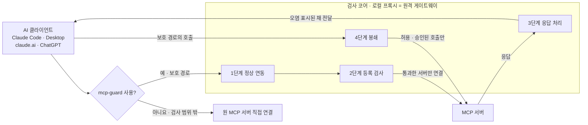

# mcp-guard

Stage 1 advisory fingerprint feeds can be refreshed from a SHA-256-pinned
external snapshot; see [external feed setup and evaluation](mvp/10-local-entry/EXTERNAL_SIMILARITY_FEED.md).

AI 클라이언트가 MCP 서버를 신뢰하기 전에 먼저 실행되는 도구 위장 방어 서비스 초안입니다.

사용자가 mcp-guard 사용을 선택하면 클라이언트는 검사 코어(로컬 프록시 또는 원격 게이트웨이)를 거칩니다. 직접 연결을 선택하면 원 서버에 그대로 연결하며 mcp-guard의 검사는 적용되지 않습니다. 보호 경로의 0단계는 선택된 연결이 코어를 거치게 하고, 1단계는 정상 MCP와만 연동되게 합니다. 2~4단계는 남는 위장 유형을 다룹니다.

> 현재 코드는 MVP 골격입니다. 0단계의 코어 쪽 승인, 2단계 등록 검사 일부, 개발용 HTTP 게이트웨이의 선택형 실조회 모드(`--live-tools`)가 있습니다. 아래는 설계이며, 구현 상태는 [SECURITY.md](SECURITY.md)에 있습니다. 설계 기준은 도면 A-01·A-02이고, 문서끼리 다르면 이 두 도면을 따릅니다.

## 방어 흐름



| 단계 | 하는 일 | 막는 유형 |
| --- | --- | --- |
| 0 보호 경로 진입 | 사용자가 guard를 선택한 연결을 검사 코어로 보냄. 직접 연결 선택은 허용 | 보호 경로의 0 우회 |
| 1 정상 연동 | 레지스트리 네임스페이스와 버전을 기준으로 정상 MCP와만 연동 (로컬 패키지 경로, A-02) | ① 신원 위장 |
| 2 등록 검사 | 재연결할 때마다 이름 바인딩, 정의 해시, 세션 격리를 검사 | ① 신원 위장, ② 정의 변조 |
| 3 응답 처리 | 응답에 출처를 붙이고 오염된 세션을 표시 | ③ 응답 오염 |
| 4 봉쇄 | 위험한 호출을 값 정책, 사람 승인, 최소 권한으로 제한 | ② 정의 변조, ③ 응답 오염 |

각 단계에서 차단을 결정하는 것은 결정적 검사(A)입니다. 분류기·LLM 신호(B)는 위험도를 올리기만 합니다. 서버 내부 동작은 검사 코어의 범위 밖이라 코드 분석, 패치, OS 격리로 따로 대응합니다.

## 막지 못하는 것

설계대로 구현해도 다음은 남습니다. 전체 목록과 방어 수준은 [threat-model.md](Docs/Core_mds/threat-model.md)에 있습니다.

- **직접 연결 선택**: 사용자가 guard를 끄면 원 서버에 그대로 연결하며 0~4단계 검사가 적용되지 않습니다. 보호 경로를 선택한 뒤 설정이 바뀌어 코어를 우회하는 경우에 대한 클라이언트 측 통제는 아직 구현되지 않았습니다.
- **비민감 세션의 공격**: 설명문 지시와 도구 인자를 통한 유출은 B 신호로만 잡힙니다.
- **처음부터 악성인 버전이나 정의**: 해시와 버전 고정은 변경만 잡습니다.
- **승인 품질**: ③ 응답 오염을 막는 효과는 사람이 승인을 제대로 하느냐에 달려 있습니다.
- **MCP를 거치지 않는 경로**: Bash·WebFetch 같은 내장 도구, 도구 호출 없이 답만 바꾸는 공격, 서버 내부 동작.

단계별 차단 효과는 아직 측정하지 않았습니다.

## 문서

| 문서 | 내용 |
| --- | --- |
| [Docs/Core_mds/architecture.md](Docs/Core_mds/architecture.md) | 실행 순서, 배치, 0~4단계, 모듈 정의(L1–L4, C1–C3, M1–M5, 2-A5, 3-A4, B) |
| [Docs/Core_mds/threat-model.md](Docs/Core_mds/threat-model.md) | 공격 유형별 방어 경로, 방어 수준, 남는 위험, 결정 대기 항목 |
| [Docs/Core_mds/roadmap.md](Docs/Core_mds/roadmap.md) | 구현 순서 |
| [Progress_map_v13.png](Docs/Core_images/Progress_map_v13.png) | 최신 아키텍처별 구현 현황. `python scripts/render_progress_map_v13.py`로 다시 생성 |
| [Docs/Core_images/](Docs/Core_images/) | 원본 도면과 진행도 원본 SVG |
| [SECURITY.md](SECURITY.md) | 현재 구현 상태, 설계와 어긋나는 부분 |
| [Docs/Core_mds/README.md](Docs/Core_mds/README.md) | 원본 도면 v2 · A-01 · A-02 (`Docs/Core_images/`) |

## Repository Map

```text
.
├── configs/                  # 예시 정책(코드 기본값과 동일)과 샘플 등록 입력
├── Docs/Core_mds/            # 아키텍처, 위협 모델, 로드맵, M4 값 정책
├── Docs/Core_images/         # 원본 도면과 최신 진행도
├── mvp/01-policy-engine-cleanup/
│   └── rule_sets/            # 규칙 계열 초안 (YARA·OPA·Sigma·Semgrep·WAF 형식)
├── mvp/02-remote-gateway-mcp/
│   └── gateway_mvp/           # 원격 /mcp 게이트웨이 코어 초안
├── mvp/03-server-registration-config/
│   └── server_registry/        # 실제 MCP 서버 등록 설정 로더
├── mvp/04-tools-list-relay/
│   ├── tools_list_relay/       # upstream tools/list 클라이언트
│   └── m2_names/              # M2 이름 검사 평가
├── mvp/05-indirect-injection-throttle/
│   └── injection_throttle/      # 요청 횟수 기반 IP 딜레이 보조 수단
├── mvp/06-http-gateway-server/
│   └── http_gateway/             # 실제 HTTP 요청을 원격 게이트웨이 코어에 연결
├── mvp/07-tools-call-upstream-relay/
│   └── tools_call_relay/          # tools/call 정책 재검사와 upstream 호출
├── mvp/08-decision-controls/
│   └── decision_controls/          # 게이트웨이 토큰 발급, 보관소 인터페이스, 활성화 분기
├── mvp/09-cloud-entry/
│   ├── cloud_entry/                 # C2 OAuth 인가 서버, C3 원 서버 자격증명 참조
│   └── deploy/                      # Dockerfile, Caddy(HTTPS), compose
├── mvp/10-local-entry/
│   ├── local_entry/               # L1 설정 생성, L2 stdio 래퍼, L3 재래핑, L4 Claude Code 훅
│   └── b_score/                  # 1단계 B 점수 학습·평가
├── mvp/11-b-classifier/
│   ├── b_classifier/             # 선택형 Horizon Labs B 분류기
│   └── b_text/                   # B 설명문 검사 평가
├── scripts/                  # 아키텍처 진행도 생성(v9–v13)
├── src/mcp_guard/            # 로컬·원격 경로가 공유하는 0~4단계 검사 코어
├── tests/                    # 표준 unittest 기반 테스트 (엔진, 규칙 계열, MVP 폴더)
├── .github/workflows/        # GitHub Actions 테스트 워크플로
├── .vscode/                  # VS Code 작업 설정
├── README.md
└── mcp-guard.code-workspace
```

## Quick Start

```powershell
$env:PYTHONPATH = "src"
python -m unittest discover -s tests
python -m mcp_guard.server --policy configs/example-policy.json configs/example-tool-registration.json
```

`mcp_guard.server`는 등록 JSON 한 건을 판정해 출력하는 CLI 샘플입니다. MCP 서버나 프록시가 아닙니다. 샘플 입력은 공격 예시라서 `block`이 나와야 정상입니다.

규칙 계열 데모:

```powershell
cd mvp/01-policy-engine-cleanup
$env:PYTHONPATH = "../../src"
python -m rule_sets.demo
```

원격 게이트웨이 MVP 데모:

```powershell
cd mvp/02-remote-gateway-mcp
$env:PYTHONPATH = "../../src;../01-policy-engine-cleanup"
python -m gateway_mvp.demo
```

서버 등록 설정 데모:

```powershell
cd mvp/03-server-registration-config
$env:PYTHONPATH = "../../src;../02-remote-gateway-mcp"
python -m server_registry.demo
```

IP 요청 횟수 딜레이 데모:

```powershell
cd mvp/05-indirect-injection-throttle
$env:PYTHONPATH = "../../src"
python -m injection_throttle.demo
```

HTTP 게이트웨이 서버 MVP 데모 (`tools/list` 검사와 `tools/call` 중계 포함, MVP 4·7의 클라이언트는 `--live-tools`에서 사용):

```powershell
cd mvp/06-http-gateway-server
$env:PYTHONPATH = "../../src;../01-policy-engine-cleanup;../02-remote-gateway-mcp;../03-server-registration-config;../05-indirect-injection-throttle"
python -m http_gateway.demo
```

결정 반영 컨트롤 데모:

```powershell
cd mvp/08-decision-controls
$env:PYTHONPATH = "../../src"
python -m decision_controls.demo
```

## Current Status

초기 골격입니다. 0단계 진입 경로가 두 가지 있습니다.

- **원격 경로(MVP 9)**: 게이트웨이를 Docker·HTTPS로 `https://<도메인>/mcp`에 배포하고, 게이트웨이가 직접 OAuth 인가 서버 역할을 합니다(C2). 원 서버 자격증명은 게이트웨이만 갖습니다(C3). 커넥터 등록 절차는 C1 문서에 있습니다.
- **로컬 경로(MVP 10)**: 로컬 stdio 서버를 fail-closed 래퍼(L2) 뒤에 두고, Claude Code·Claude Desktop 설정 생성(L1), 설정 감시·재래핑(L3), Claude Code 훅(L4)을 제공합니다.
- **선택형 B 분류기(MVP 11)**: `--b-classifier`로 Horizon Labs 모델을 켜면 도구 설명문은 `review` 신호로, 도구 응답은 감사 점수로 기록합니다. 기본값은 꺼짐이며 별도 패키지와 모델 파일이 필요합니다.

두 경로는 같은 검사 코어(`src/mcp_guard`)를 씁니다. 로컬 경로는 Claude Code 세션의 오염 표시와 오염 세션의 내장 도구 차단까지 합니다. 운영 서버는 `--server asgi`(uvicorn)입니다. M1은 업스트림 JSON/SSE의 최종 응답을 JSON으로 반환하며 클라이언트 방향 스트리밍은 범위에서 제외합니다(D6-29). M4 값 정책은 정책 파일에 `m4_value_policy`를 설정하면 로컬·원격 호출마다 적용됩니다. 설정과 승인 명령은 [M4 값 정책 안내](Docs/Core_mds/m4-value-policy.md)에 있습니다. 실제 클라이언트·원 서버 OAuth·클라우드 배포 검증은 남았습니다. 모듈별 상태는 [SECURITY.md](SECURITY.md)에 있습니다.
